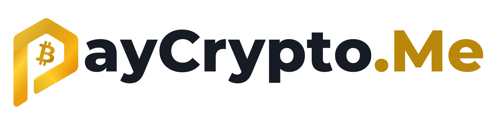

<h1 align="center">
  <picture>
    <source media="(prefers-color-scheme: dark)" srcset="./assets/paycrypto-me-dark.png">
    
  </picture>
</h1>

**We build open-source tools for merchants who want to accept Bitcoin in wallets and nodes they control.** Our WooCommerce plugin puts that choice at checkout. Our PHP projects explore the questions behind it. How does a store give each order its own receiving address? When two transfers arrive, what evidence tells the merchant that one order has been paid?

[Install the WooCommerce plugin](https://wordpress.org/plugins/paycrypto-me-for-woocommerce/) · [Explore the architecture](https://github.com/paycrypto-me/paycrypto-me-core-php/blob/main/docs/PUBLIC-ARCHITECTURE.md) · [Visit PayCrypto.Me](https://paycrypto.me/)

## Accept Bitcoin in WooCommerce

At checkout, a customer can scan a QR code to pay **on-chain** or **over Lightning**. For on-chain payments, the store can derive a fresh address for each order from the merchant’s extended public key or use a fixed receiving address. For Lightning, the merchant connects their own BTCPay Server or lnd node. Funds go directly to the merchant. In the free plugin, the merchant handles fiat conversion and confirms payment manually.

[Read the setup guide](https://github.com/paycrypto-me/paycrypto-me-for-woocommerce#configuration) · [Browse the plugin source](https://github.com/paycrypto-me/paycrypto-me-for-woocommerce) · [Get help on WordPress.org](https://wordpress.org/support/plugin/paycrypto-me-for-woocommerce/)

## Explore the PHP projects

The checkout gives us real payment problems to design around. Our public architecture describes how we intend to divide that work. A storefront or another application calls the **SDK**, the SDK exposes payment behavior from **Core**, and Core delegates public-key and protocol operations to **Primitives**. Other projects can also use Primitives independently.

| Project | Question it owns | What you can explore today |
| --- | --- | --- |
| [SDK PHP](https://github.com/paycrypto-me/paycrypto-me-sdk-php) | How should a PHP application ask for payment instructions and present them to a customer? | The integration design and the questions still open before the API is settled. |
| [Core PHP](https://github.com/paycrypto-me/paycrypto-me-core-php) | If a customer sends a small test transfer and then the balance, what connects both transfers to one payment? | The domain design for payment routes, receiving addresses, invoices and the evidence needed to accept a payment. |
| [Primitives PHP](https://github.com/paycrypto-me/paycrypto-me-primitives-php) | Given public wallet data, how can we derive a receiving address and independently verify the result? | PHP code, protocol test vectors and reviews of the libraries that perform the underlying operations. |

**Supply Chain Assurance** is a separate area of the public architecture that spans these projects. Its scope is introduced in the [public architecture map](https://github.com/paycrypto-me/paycrypto-me-core-php/blob/main/docs/PUBLIC-ARCHITECTURE.md).

## Follow one receiving address

Start with the plugin’s “fresh address for each order” option. In Primitives, **PayCrypto.Me Improvement Proposal 0003** follows the underlying public-address derivation problem from wallet input to encoded address. Its execution plan links the experiments, their results and the reviews that changed the design. For a concrete example, issue #25 shows how reviewers checked what happens when an address encoder returns a plausible but incorrect result.

[Read the PIP-0003 execution plan](https://github.com/paycrypto-me/paycrypto-me-primitives-php/blob/main/docs/pips/PIP-0003/EXECUTION-PLAN.md) · [Follow the codec review](https://github.com/paycrypto-me/paycrypto-me-primitives-php/issues/25)
